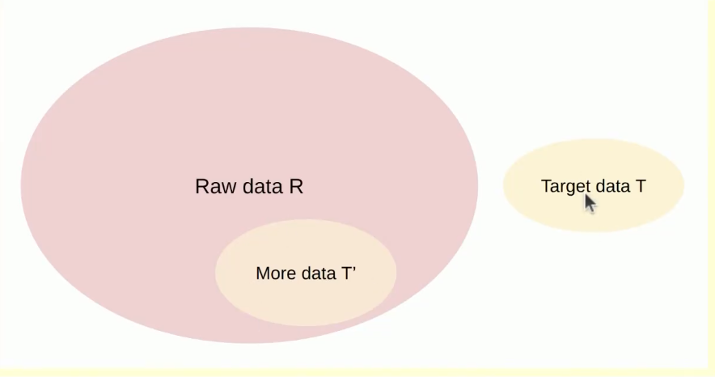
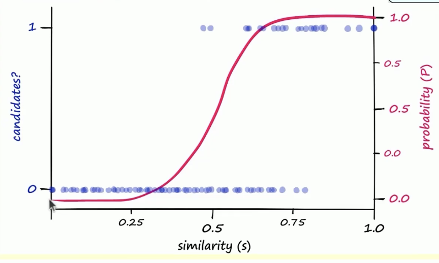

* data source 高质量数据从哪里来？
	* 维基百科
	* github
	* arxiv
	* books
	* common crawl 一个爬取了大量网页的数据集
	* 从互联网上获取的原始数据参杂了大量低质量数据，需要进行过滤；一般有基于规则的方法和基于分类器的方法。过滤后数据往往只占原始数据的个位数百分比
* transformation
	* HTML to text：通常based on rules，如trafilatura， resiliparse
	* PDF  to text：OCR。PDF的数据质量往往高于网页
* filtering
	* 
	* 基于模型的过滤方法
		* 生成式模型：score(x) = p_T(x)
		* 简单分类器：score(x) = p(T | x)
		* 筛选score(x) > threshold
	* 基于某种规则的过滤方法
	* 如果训练周期较长，可以容忍较低质量的数据
	* 如果训练周期较短，对数据质量的要求更高
* deduplication
	* 互联网上有大量重复数据：镜像站点、fork repository，以及大量的近似数据。
	* 精确去重：两两比对时间复杂度是O($N^2$)；往往使用hash函数，去重那些哈希冲突的item
	* 近似去重
		* jaccard相似度：$A \cap B$ / $A \cup B$  
		* minhash signature：取n个哈希函数对setA做哈希映射，并记录下$\{min\{hash_i(item), item \in setA\}| i \;in \;range(0, n)\}$，作为setA的minhash signature。随机取一个hash函数，setA和setB的最小哈希值相同的概率恰好等于二者的jaccard相似度，因此A的签名与B相同的数量的期望即jaccard相似度
		* locality sensitive hashing：利用minhash仍然要进行两两比对，开销极大。将长度为k的signature分为b个band，每个band有r行。对于两个集合，假设jaccard相似度为s，一个band中的minhash值全部相等的概率是$s^r$，没有任何band相等的概率是$(1-s^r)^b$ ，至少有一个band相等的概率是$1-(1-s^r)^b$，这就是这两个集合被LSH算法召回为候补pair的概率形成了一条陡峭的曲线，当similarity超过某个threshold，被召回的概率迅速增加；增加r时，曲线右移；增加b时，曲线左移；增加b和r时，曲线变得更加陡峭；threshold的值可以被计算为$(1 / b) ^{1 / r}$
* data mixing
	* baselines
		* by intuition
		* uniform sampling
		* sample proportional to the number of tokens 
	* example:低质量数据集有10T数据，高质量数据集有10B数据，训练1T tokens，uniform sampling，低质量数据集平均训练了0.05epoch，高质量数据集平均训练50个epoch——严重的overfitting
	* 可以为每个数据源训练的epoch数设定上限
	* regression-based mixing：在小型模型上采用不同的混合方案，得到不同的target分数，并以此来训练一个回归模型，用回归模型预测最佳数据比例
	* problem：如何定义数据分布、如何定义回归策略、如何定义target分数、大小模型之间的差别。小模型下最佳的数据配比是否适用于大模型？大模型训练所需token数更多，使用相同的数据配比可能导致某些数据源训练多个epoch而过拟合。解决方法：限制每个数据源训练的epoch数、在训练小模型时就按照训练所需token数的比例下采样训练数据。
* post-training data
	* 后训练中大量采用合成数据（example：OpenThoughts）
		* 定义一组环境
		* 定义一组任务
		* 从强大的模型中收集回复
	* 真实数据，如github PR，给定一个环境，一个代码仓库以及bug，让模型学会修复
		* SWE—smith
		* SWE-Zero