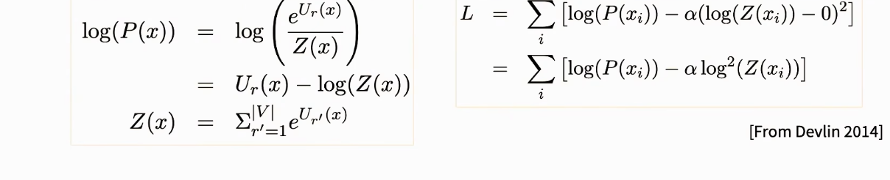

* post-norm vs pre-norm 
	* post-norm实际上是residual-norm，norm层存在于残差流上，而pre-norm提供了一个干净的残差流，训练上更加的稳定。实际上，norm只要不在残差流中，在注意力层和FFN层之后也是可以的
* RMSNorm 
	* 去掉了偏置项，这在实践中没有表达能力的损失，并获得了系统层面的优化，因为我们希望去掉那些涉及内存搬运、对GPU利用率低而对表达能力没用太大帮助的操作
* activation 
	* 门控网络是如今被普遍采用的激活机制。以SwiGLU举例，其公式为FFNSwiGLU = (swish(xW)  $\otimes$ xV)W2 其中$\otimes$是逐元素相乘。GLU变体几乎总是优于非GLU变体。值得注意的是，引入门控网络后，为了保证参数量不变，前聩维度d_ff需要变为原来的2/3
* 位置嵌入 
	* 我们希望位置嵌入函数f满足<f(x, i), f(y, j)> = g(x, y, i - j)。rope即旋转位置嵌入，将d_model两两配对，在二维平面上旋转。位置i的第k组向量旋转角度为i *  $\theta^{-(2k - 2) / d_k}$ , for k in range(1, d_k // 2)
* hyperparameters
	* d_ff / d_model 一般取4倍。值得注意的是，若引入GLU，为保持参数量不变，应为8 / 3倍
	* d_model / n_layers 约在100左右。模型深度是出于表达能力的考量，宽度是出于系统并行优化的考量
	* vocab_size 单语模型30-50k， 多语模型100-250k
	* dropout and regularization 在数据不受限的情况下模型几乎不会见到一份数据两次，因此过拟合不成为一个问题。weight_decay往往不是为了正则化，而是与优化器互作
* 稳定性问题 softmax里有指数运算和除法运算，对数值稳定性非常危险。
	* z-lossU是模型的输出，是稳定的，而Z是不稳定的。Z越接近1数值越稳定，因此我们在损失中惩罚Z，即Z-loss
	* QK-norm 为了保持attention-layer中softmax的稳定性，也可以在得到Q和K后进行归一化。
	* logits-softcap 也是处理softmax稳定性问题的技巧。logits<-soft_cap * log(logits / soft_cap)，对logits做截断以保证其不会过大或者过小。
* GQA 
	* 为了在推理过程中减少内存占用，以提高算术强度 / 加速器强度（见[2.Pytorch（einops）](2.Pytorch%EF%BC%88einops%EF%BC%89.md)），允许一组KV共享多个Q