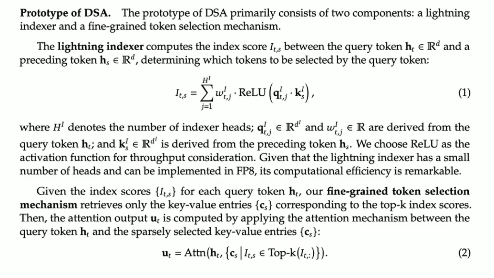
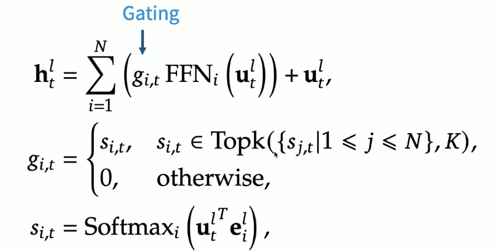
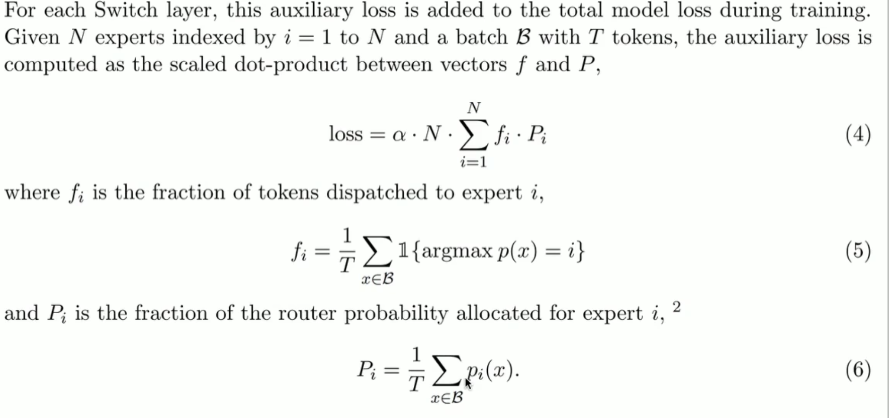
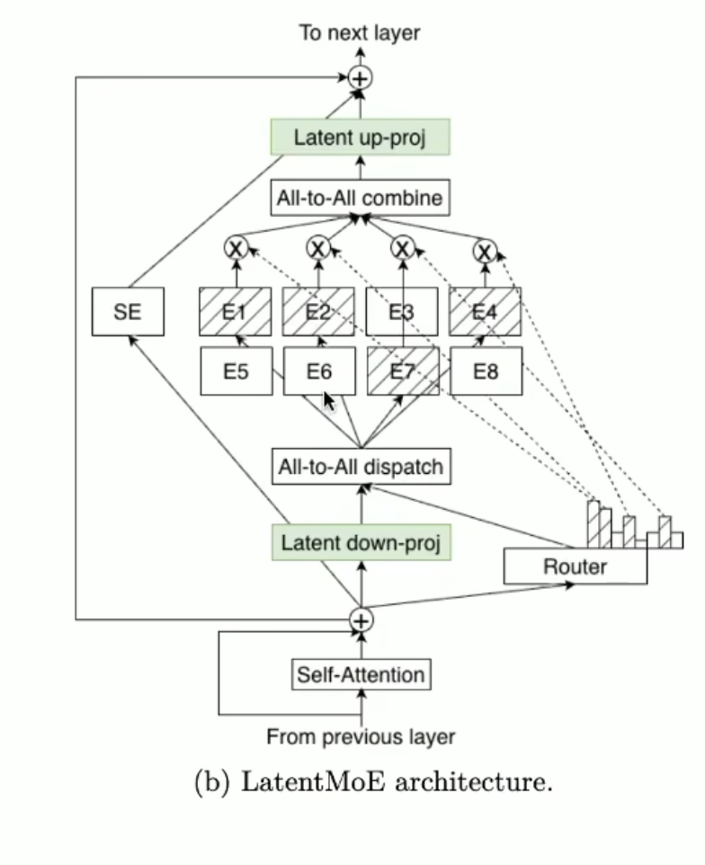

 * Linear attention
	* 我们把注意力计算记作$\rho$ (Q$K^T$)V，在一般的全注意力机制中，$\rho$为softmax函数。加入我们把$\rho$简单定义为恒等变换，注意力变为(Q$K^T$)V，这个计算的cost是$n^2 * d_k + n^2 * d_v$。应用矩阵乘法结合律， Q($K^T$V)的cost是$2 * n * d_k * d_v$。我们把依赖于context length平方的全注意力机制优化为了线性注意力
* 线性注意力循环形式
	* 在计算$K^T$V时，可以采用如下类似于RNN的循环形式$S_t = S_{t-1} + k_t v_t^T$ ,$y_t = q_t^T S_t$ 。在训练时可以采用矩阵乘法的形式而在推理时可以采用循环形式
* Mamba-2
	* $S_t = \gamma_tS_{t-1} + k_t v_t^T$ ,$y_t = q_t^T S_t$ ,$y_t = q_t^T S_t + v_t^TD$ ，其中$\gamma_t = f(x_t)$ ，只依赖于当前输入而非状态
* gated delta net
	*  $S_t = \gamma_t(I - \beta_tk_tk_t^T)S_{t-1} + \beta_t k_t v_t^T$ ,$y_t = q_t^T S_t$ ,$y_t = q_t^T S_t + v_t^TD$ ，其中$\gamma_t = f(x_t)$ ，$\beta_t = f(x_t)$.$\beta$是一个门控，表明我想从当前输入读取多少信息。$(I - \beta_tk_tk_t^T)$则是一个投影，表示在写入当前信息时，我想要提前擦除状态空间中所有k方向的信息
* do sparse attention
	* 用一个轻量级的索引器做全注意力计算以挑选出top-k个token，并最终使用k个token做真正的注意力运算。在索引器中，所有的q共享一组k。w是由当前token生成的权重，用于对所有头加权求和。
* MOE
	* 在不增加推理成本的前提下增加参数量，当然这增加了通信成本
	* routing function 基本上采用的是token选择专家的方式。top-k路由是最常见的方式，哈希路由则是一种常见的baseline；使用强化学习的方法也是一种思路，但是并不常见。
		* top-k路由
	* shared expert and fine-grained experts 共享专家是指所有token都会经过的专家。引入共享专家可以处理一些通用操作而让其余专家更加内化。研究表明，使用细粒度专家对于模型的表达能力有好处，但更多的专家数量显然会带来通信成本的提升。
	* 训练方法
		* RL方法
		* 随机近似引入了随机噪声来增加探索
		* heuristic balancing losses 直接训练top-k router的问题是这是一个极度偏向剥削而非探索的算法。我们通过引入auxiliary loss来希望增加探索，以实现负载均衡。其中f反映了专家的真实负载，而p提供了可微性。
	* latentMOE
		* 细粒度专家对表达能力有益，但专家间的通信需要成本。于是人们提出了latentMOE。共享专家无需通信，故输入以原维度通过；而对于路由专家，输入将先被投影到较低维度以降低通信成本
	* stability top-k router中存在softmax，这会带来稳定性问题。我们往往使用fp32精度来处理这里的softmax，有时也引入zloss
	* fine-tune overfitting
	* upcycling
	* deepseek models