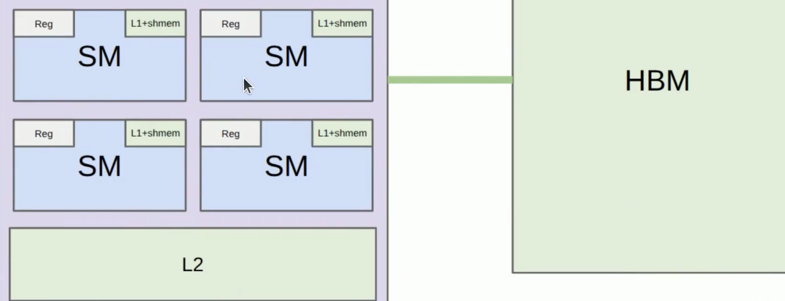
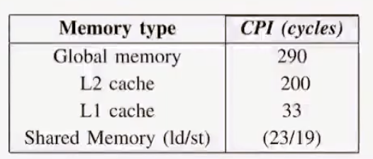
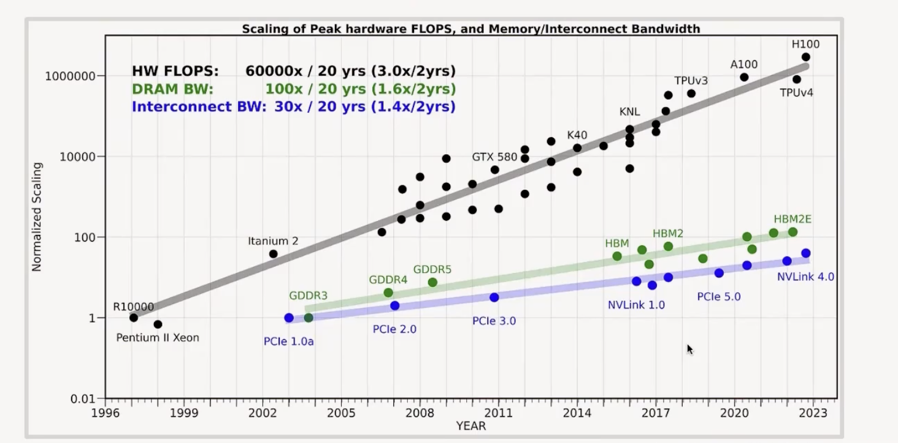
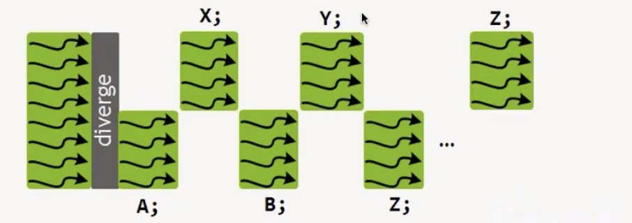
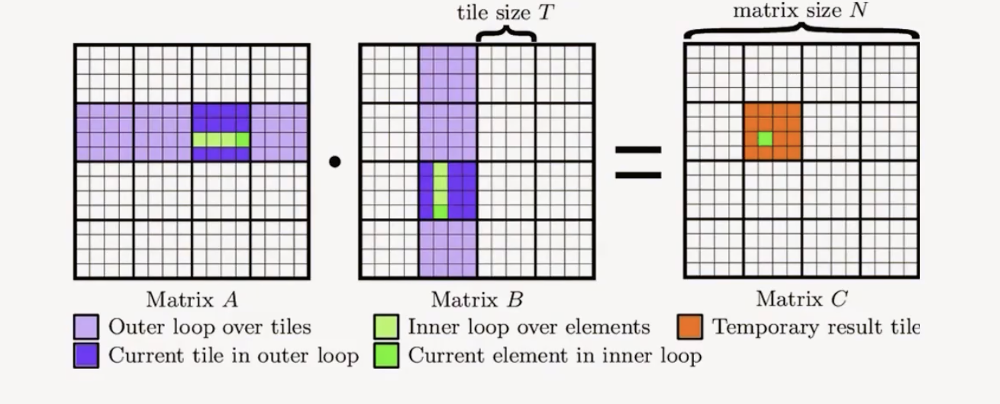
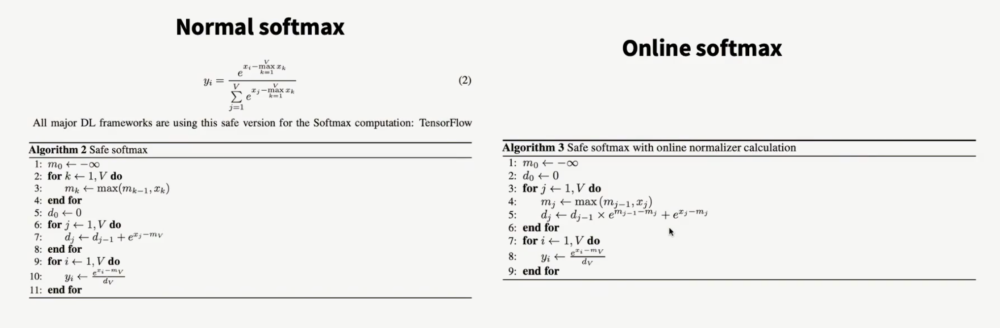

* GPU
	* SM(streaming multiprocessors)是组成GPU的基本单元，其是一个独立的计算单元，内部包含多个SPs(streaming processor)。GPU的存储部分包括了shared memory， L1 cache, L2 cache与HBM。其中shared memory与L1 cache是属于一个SM的，L2 cache与HBM则是共享的；前三者使用的是SRAM而HBM使用的是DRAM。速度参考如下。
	* GPU不同组件的发展速度是不同的。如图所示，FLOPS的发展速度远远快于内存与通信。因此内存与通信正越来越多的成为运算瓶颈
	* programming model 
		* thread 线程是编程的最小执行单元，按SIMD模型并行工作
		* warp warp是GPU实际调度执行的基本单位，在NVIDIA GPU上一个warp一般包含了32个thread，一个warp里的所有线程会执行同一条指令
		* block block是CUDA编程模型里显式组织线程的单位，一个block里的所有线程保证运行在一个SM上，因此可以使用shared memory，也可以使用同步屏障
		* grid grid是一次kernel launch中启动的全部blocks
* accelerating tricks
	* control divergence 尽量避免执行分支判断。因为threads采用SIMD模型，必须执行相同的指令，因此当出现分支时，部分线程执行分支A而其余线程空转，之后其余线程执行分支B而其他线程空转，从而浪费了时间
	* low precision
		* 16-bit就可以应付的运算
			* 矩阵乘法
			* 大多逐元素运算(relu, tanh, add, sub)
		* 需要更多精度的运算(FP32/FP16)
			* 小数与大数相加
			* reduction operations(sum, softmax, normalization)
		* 需要更大范围的运算(FP32/BF16)
			* exp, log, pow等
		* FP8格式没有一种标准的格式。下面介绍MXFP8格式。
			* E4M3（4位阶码，3位尾数）
			* scale factor采用FP8（E8M0），把数据按小块分组如32个一组，一组采用一个缩放因子
			* 转置矩阵可能变得十分复杂！因为需要重新量化，重取scale factor。实际上会为每个量化矩阵创建两个副本以处理转置问题
		* MXFP4 E2M1，表示-6到6，scale factor采用FP8，E4M3，每16个数据一个scale factor
	* operation fusion
		* 经典的pytorch函数中，每调用一次kernel都要读写内存，从而增加了开销。我们可以重新编写一个新的kernel，集成了所需的所有操作但只需要一次内存读写，从而降低开销
	* recomputation 
		* 不存储激活值，而是在反向传播时重新计算。这增加了计算开销，但是减少了内存读取开销。
	* memory coalescing 
		* 由于突发传输机制，位于同一个突发传输段中的数据可以免费获取。如果一个warp中的所有线程都位于一个突发传输段中，则称为coalesced。这也是为什么Linear module中权重矩阵时转置存储的
	* tiling
		* 我们不希望频繁读写内存；在矩阵乘法时，我们有大量重复读写的数据；我们希望把数据一次性全部读入shared memory中，并将计算结果一次写出然而，我们没有这么大的shared memory，因此我们需要将矩阵分块，利用分块矩阵乘法，一次计算一块。
* Flash Attention
	* recomputation
	* tiling
	* online softmax
		* softmax是一个全局操作，这意味着我们需要一整行的数据而没法利用分块机制。但是如果我们修改softmax的算法，将softmax修改为一个online操作，我们就可以一块一块的去计算一行的指数和。
* Triton与CUDA
	* CUDA 是 NVIDIA 提供的 GPU 编程平台和语言扩展。它更接近底层硬件。使用CUDA时，采用C/C++风格的代码，需要直接考虑每个线程处理那些数据、控制shared memory等，但也提供了更强的控制力和更高的性能上线。
	* Triton 是一种更高层的 GPU kernel 编程语言，常用于写深度学习算子。允许以python风格编程，无需直接管理每个thread，编译器会处理很多底层细节。其编程的基本思想是吧数据载入shared memory， 用block-level tensor操作表达计算，再把数据写回HBM。显然Triton的控制力和性能上线不如CUDA且依赖编译器。