 * collective operation
	 * rank 指某一特定的设备
	 * world size 设备数量
	 * broadcast copy from rank0 to all ranks
	 * scatter scatter tensor on rank0 to all ranks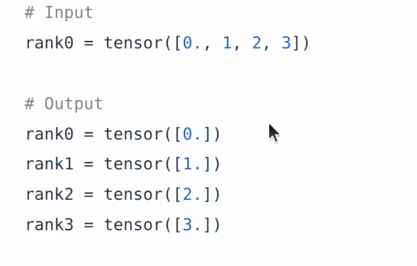
	 * gather the inverse of scatter
	 * reduce pieces from all ranks to rank0, applying some operations(e.g.,sum, min, max)
	 * all-gather gather + broadcast
	 * reduce-scatter reduce + scatter
	 * all-reduce reduce-scatter + all-gather(reduce + broadcast)
	 * all-to-all 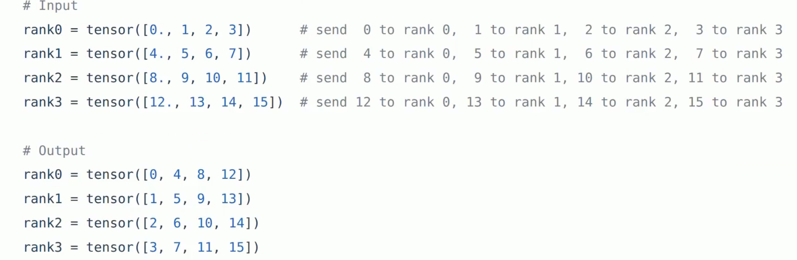对于平衡分割，基本上可以认为是一次转置
* hardware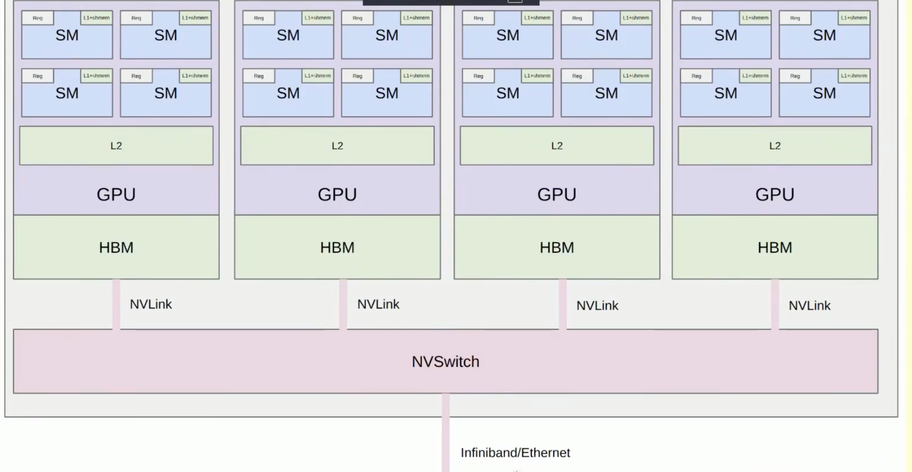
	* typical setup
		* 8GPUs per node, connected by NVlink to an NVSwitch(B200 NVlink 5.0 gets 1.8TB/s, while HBM was 8TB/s)
		* 256 nodes per pod connected by infinivband(via PCIe -> HCA/infiniband NIC -> infiniband cable)(0.05TB/s)
		* N pods per cluster,connected by Ethernet(via PCIe -> CPU)
	* remote direct memory access(RDMA)
		* allows one GPU to directly read/write another GPUs memory without involving the CPU(NVlink、NVSwitch、infiniband support RDMA)
		* RDMA  over converged Ethernet(RoCE) Ethernet bypasses CPU, similar but cheap/weak than infiniband
* some libraries
	* NVIDIA Collective Communication Library(NCCL) 英伟达底层实现GPU集合操作的库
	* torch.distributed 在pytorch中为集合操作提供了简单的接口，对于不同硬件调用不同底层库：gloo（CPU）、nccl（GPU）
* 并行化方式
	* data parallelism
		* 需要在所有rank之间同步梯度，即做all-reduce。计算扩展性很好，但是完全没有内存扩展性（每个gpu还是要存下整个模型）
		* 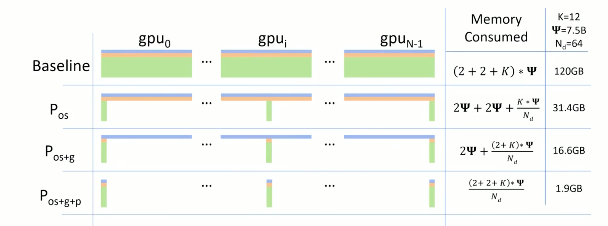
		* ZeRO1 把优化器状态分片到不同GPU中。免费的内存优化。
		* ZeRO2 把梯度也分片到不同GPU中。几乎是免费的。
		* ZeRO3（FSDP） 把参数也分片到不同GPU中
		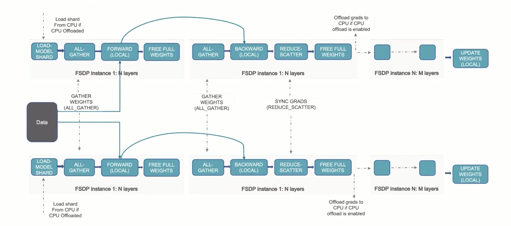做了两次all-gather和一次reduce-scatter，1.5x的通信量（朴素DDP做一次all-reduce）。可以通过把通信和计算重叠起来降低通信成本。
	* tensor parallelism
		* 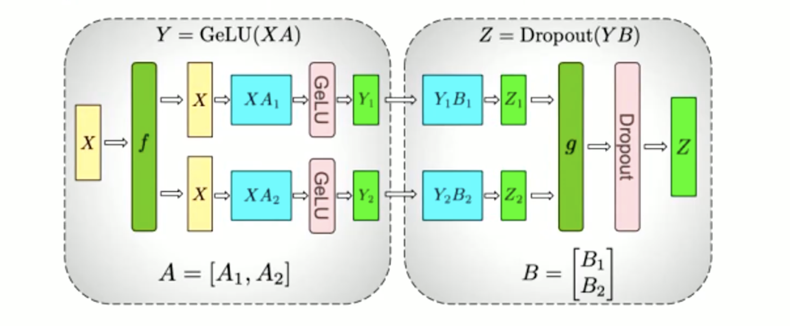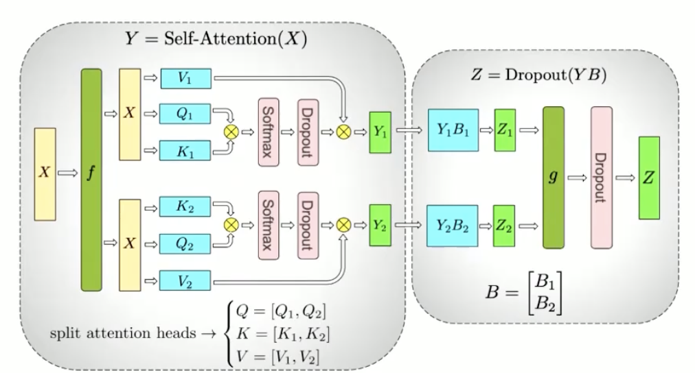
		* 前向传播时f是恒等函数，g是all-reduce；反向传播时g是恒等函数，f是all-reduce
		* A采用列切分，B采用行切分。否则，在GeLU前需要再做一次通信，增加成本
		* 在注意力层中，多头注意力机制几乎天生就是为TP准备的。因此我们一般保证头数是GPU数的倍数
		* 涉及大量的通信，通常在NVlink域内进行
	* 流水线并行
		* 按层拆分网络，每个rank处理一部分层
		* 会产生pipeline bubbles 
		* 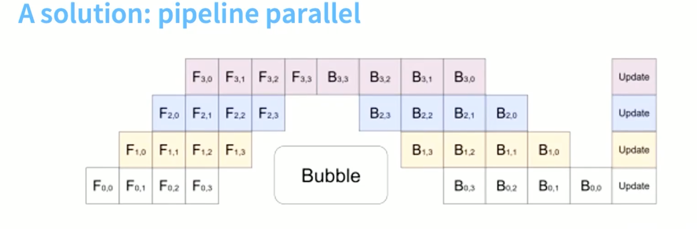通过分割microbatch可以减少bubble。pipeline paralelism的通信成本比较低，基本只需要在不同pipline block之间通信。通过一些更巧妙的安排，可以将feedforward和backforward穿插起来，进一步减少bubble的大小。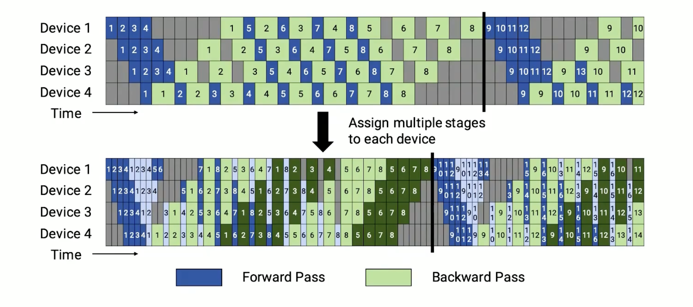拆解后向传播的结构也可以为流水线并行提供更好的性能。后向传播中有两件事需要进行，一是计算激活值的梯度传给前一层，二是计算当前层参数的梯度。其中，一的延迟对流水线的进行至关重要，而二仅是当前层内部的事务。因此可以及时处理一而在空闲时处理二，以增加效率。
	* sequence paralelism
		* 序列并行一般与TP一同使用，用于上下文较长的情况。在前向传播中g是all-gather，g* 是reduce-scatter，反向传播时相反。前向传播时，进入TP前需要all-gather获取完整的x，而TP完成后，因为要进入SP，每张GPU不需要完整的x，因此TP中的all-reduce可以替换成reduce-scater。反向传播则相反。
		* 加入SP后，通信量没有改变，但是增加了内存扩展性，因为减少了激活值的显存占用（没有减少参数）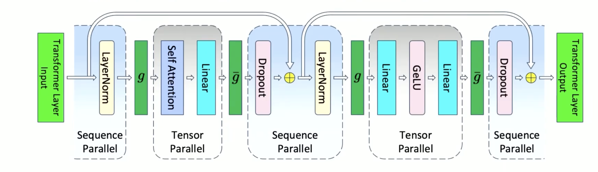
	* expert paralelism
		* 即把专家分散到不同的GPU，一般与DP一同使用，即每个GPU处理不同数据；一般EP数量与DP相同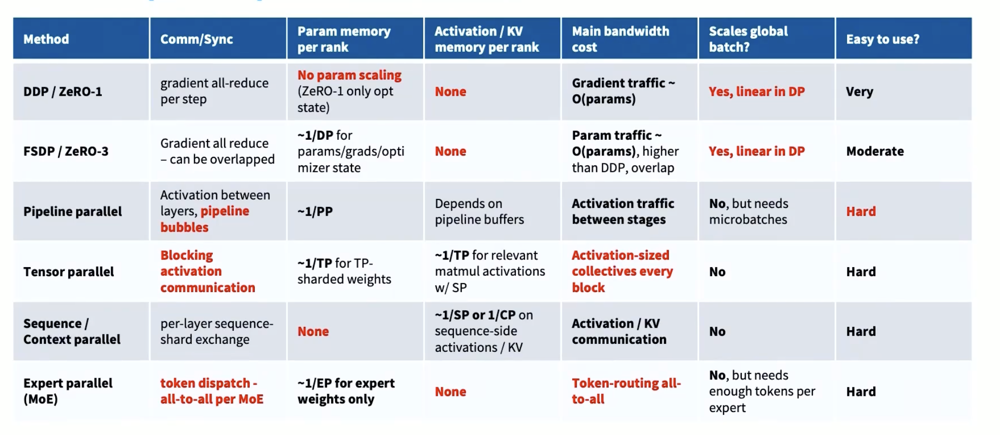
* strategies
	* 
	