* data scaling law
	* 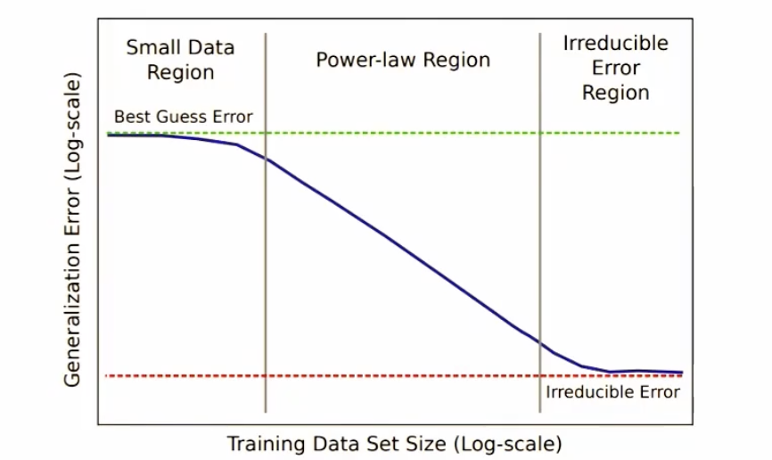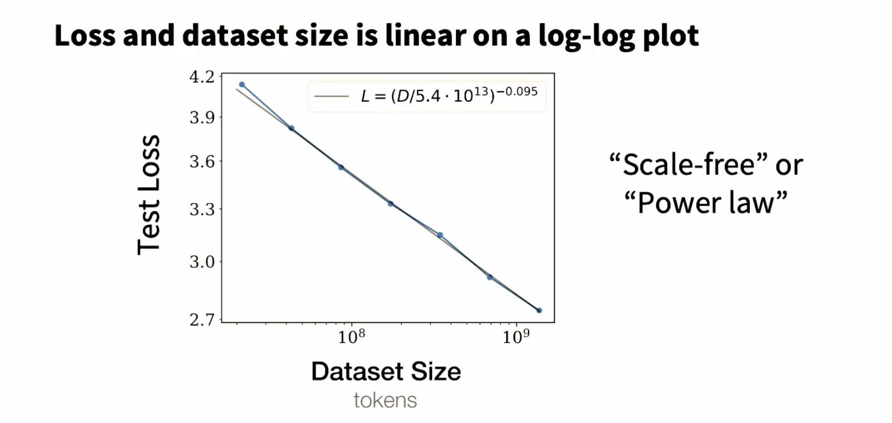loss和data size在双对数图中呈现线性关系，这表明loss和data size存在多项式关系
	* 对于数据组成，数据混合比例只影响双对数图中的截距，斜率由模型本身决定。可以用caling law寻找最佳的数据配比，但在实际场景下噪声很大，直接用小规模下的最佳配比x效果也可行。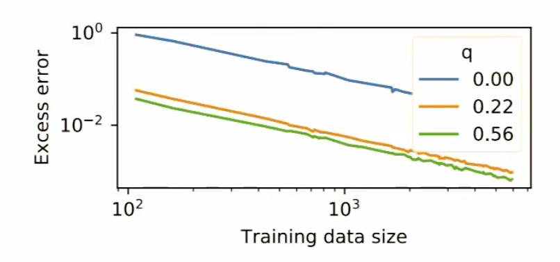
	* data repetition 
		* 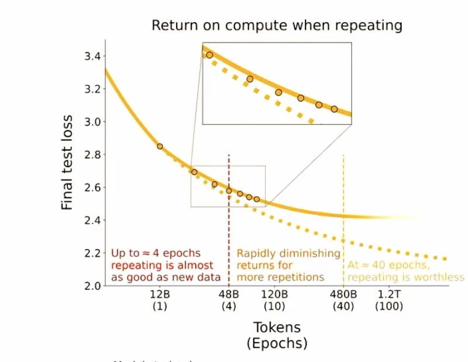对于重复数据，在前4个epoch几乎不会有影响，但在之后的scaling law曲线会明显偏差
		
*  embedding parameters
	* 带不带embedding parameters会对scaling law的双对数图产生神奇的影响。
* critical batchsize
		* 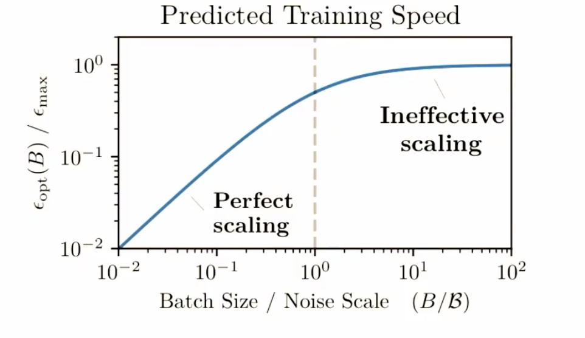在critical batch size之前，增大batch size的收益是正比的。critical batch size可以用scaling law预测，与目标损失成多项式关系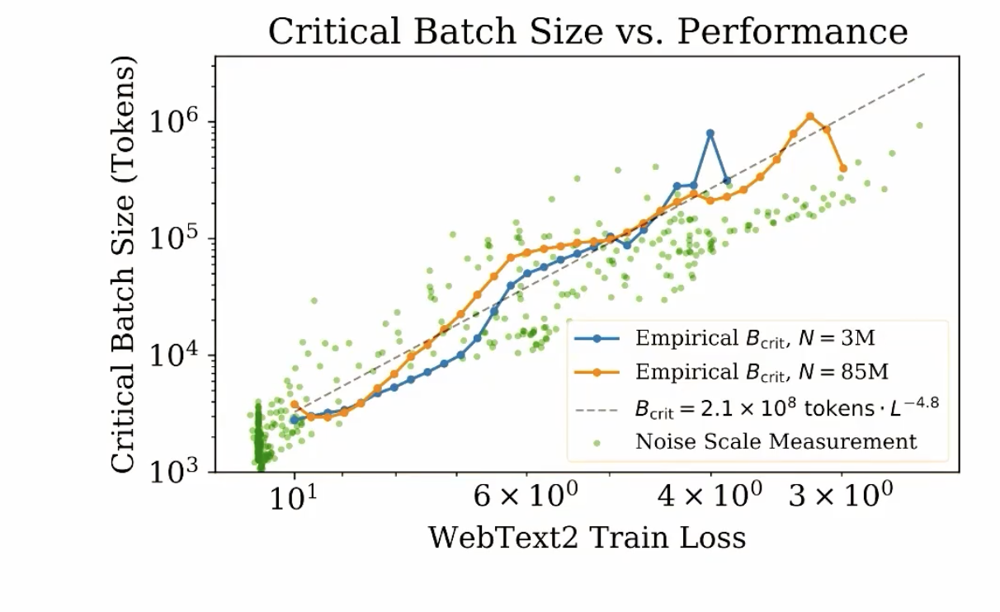
* optimal lr
	* 最佳学习率也可以使用scaling law确定。最佳学习率与模型大小成多项式关系。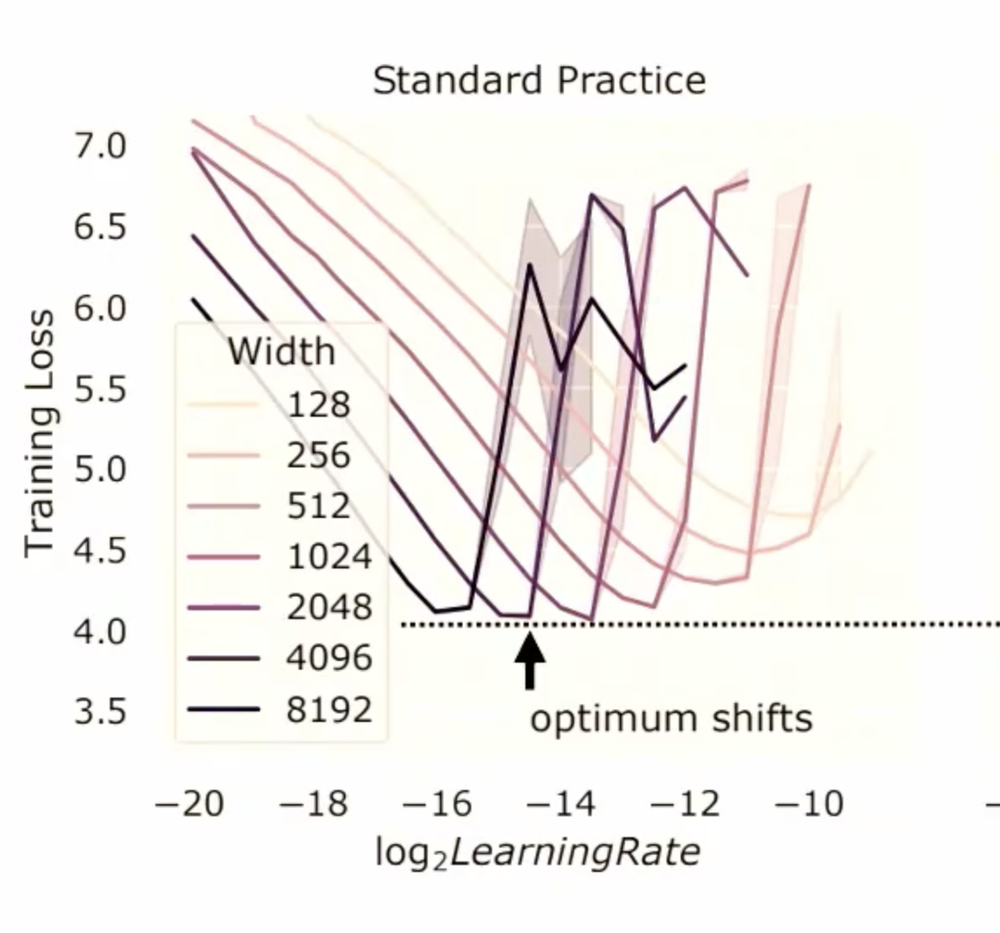
* downstream
	* 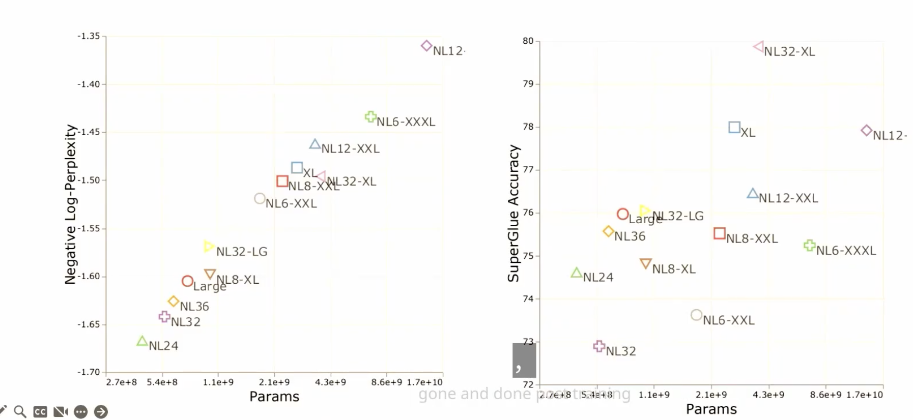scaling law 往往用于loss or perplexity等上游指标，对于一些下游指标，其结果并不像上游吻合的那么好。
* joint scaling law
	* 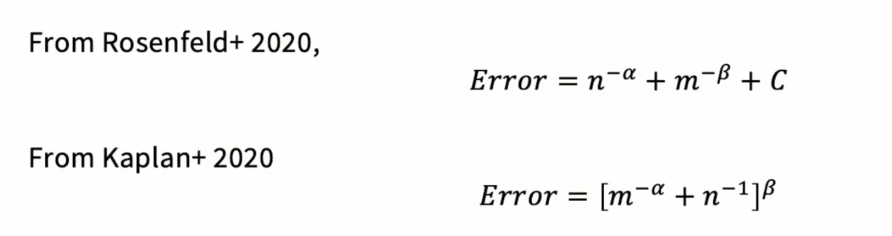
* model_data tradeoff
	* kaplan
		* 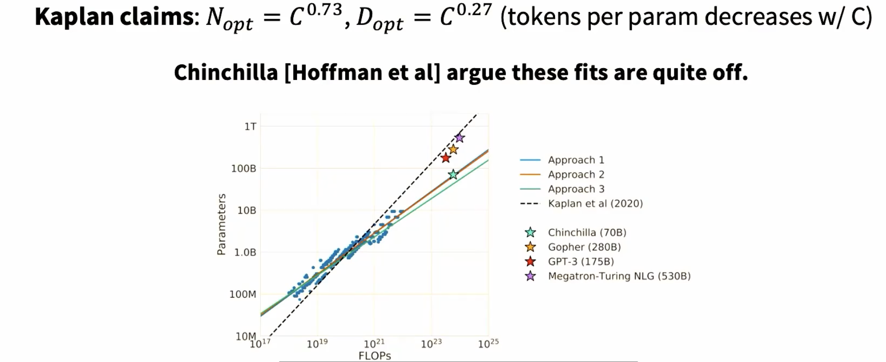
	* chinchilla
		* 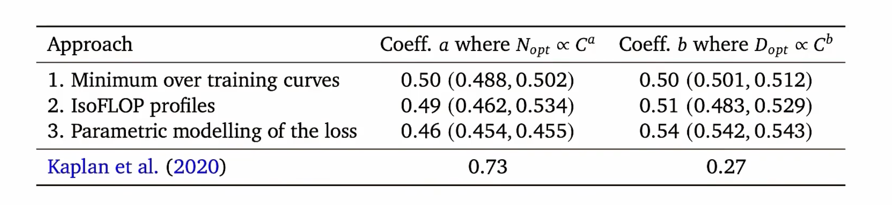
	* 对于kaplan预测的scaling law，当算力增长时，会有越来越多的算力投入到模型规模中，每个参数分配到的token数会越来越少。而对于chinchilla来说，其预测的模型参数与数据量几乎同步增长。这意味着最佳tokens/parameters几乎是个常数，chinchilla认为其应该约为20。而在实际应用中，消耗了大部分算力的是为客户提供的推理服务，这意味着我们不希望模型太大而在推理时消耗过多算力，所以在实际应用中模型往往是过训练的（tokens/parameters > 20）
* isoflops
	* isoflops是一种很好用的研究工具，对于给定的flops预算，扫描一遍其他所有自由度，观察loss曲面即可得到结果。