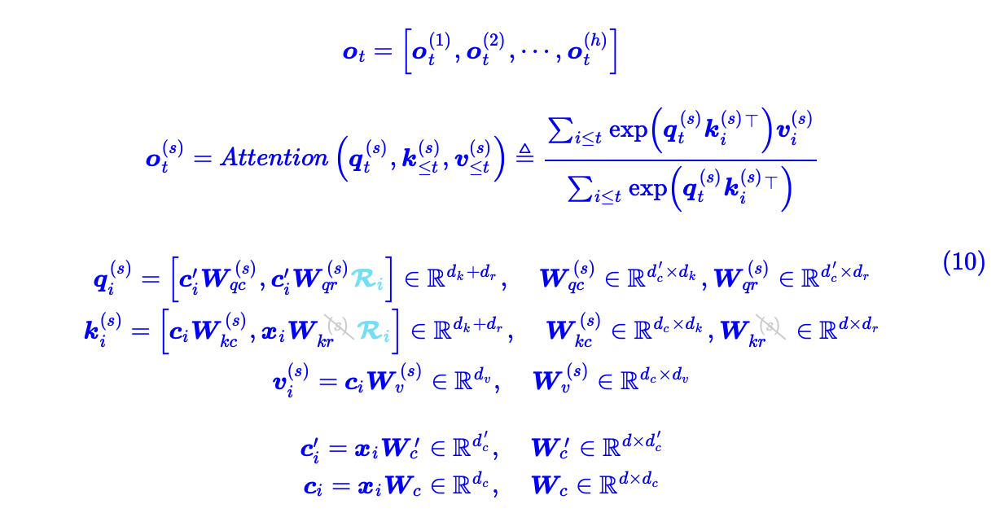
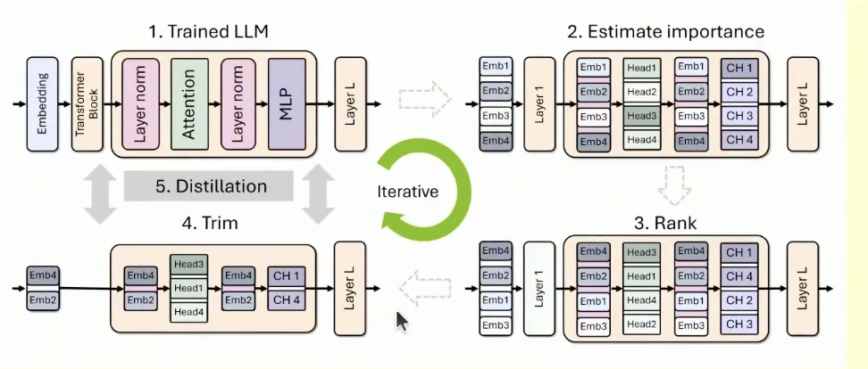
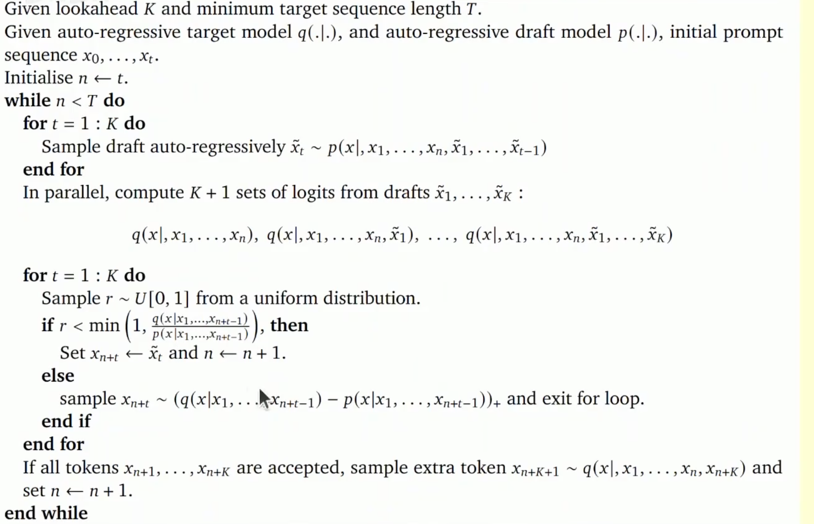
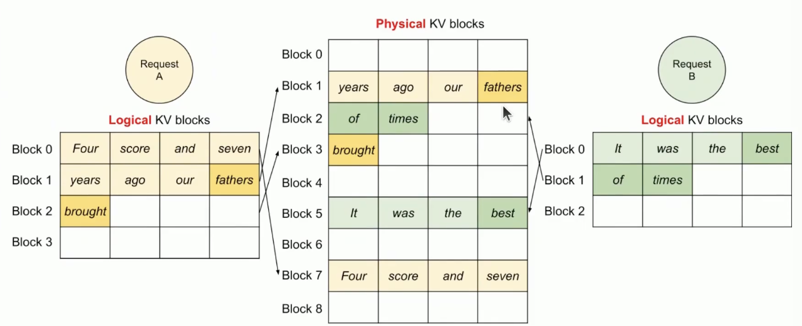

* inference 是一件非常消耗算力的事，甚至大于训练一个LLM
* 几个评价inference的指标
	* time-to-first-token(TTFT)基本就是prefill的时间
	* latency（seconds/tokens）
	* throughput（tokens/seconds）
* 算术强度
	* MLP：B * T，训练时T=S，推理时T=1
	* attention：TS/S+T，训练时为S/2，推理时为S/S+1
	* 可以看出，推理时的attention计算是内存受限的
* tradeoff
	* 在latency和throughput之间存在tradeoff，因为吞吐量=batchsize/latency，B越大，延迟越高，但吞吐量反而越大
* kv cache
	* 内存是inference的瓶颈，而kv cache占用了很多内存，因此减少kv cache是加速推理的优化方向
	* GQA 几个query共享一组kv，从而减少kv cache
	* MLA 训练
	* 解码缓存一个被压缩的向量$c_t^{KV}$和$K_t^R$。KV Cache 从“每个 head 都存一份 K/V”变成“存一个共享的低维 latent”，大幅降低了显存开销。MLA和RoPE不兼容， 因此每个Attention Head的Q、K新增dr个维度用来添加RoPE，其中K新增的维度每个Head共享。
	* 滑动窗口注意力 推理时只关注滑动窗口内的k个token，从而kv cache不再是上下文长度的·函数
* 模型剪枝
	* 
* 模型量化
	* QAT（量化感知训练）：在训练时就模拟量化与反量化的误差，让模型适应量化的影响
	* PTQ（训练后量化）：模型训练完毕后量化，开销更低
* 猜测解码
	* 
* 动态负载
	* 连续批次，批次动态更新，旧的请求完成后剔除，加入新的请求，保持批次大小不变。问题在于每个请求序列长度不同；这在attn中确实无法处理，但在MLP中可以拼接为一个大的向量处理
	* 
* 分页缓存